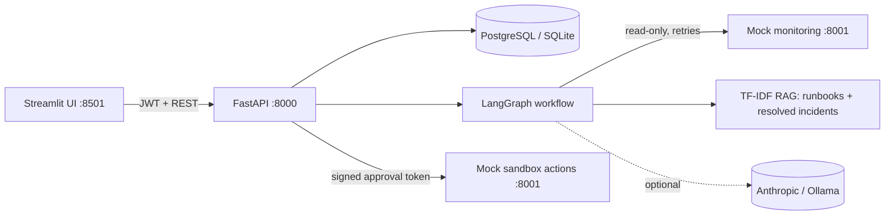
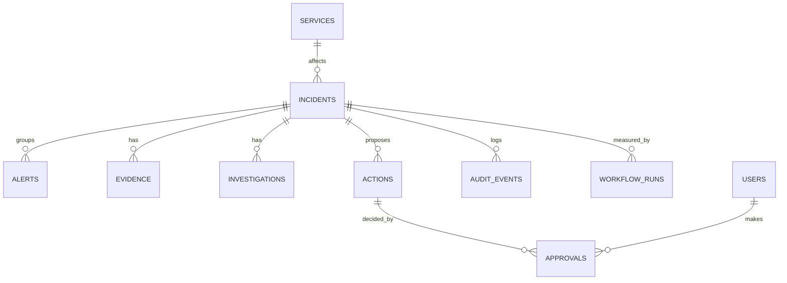
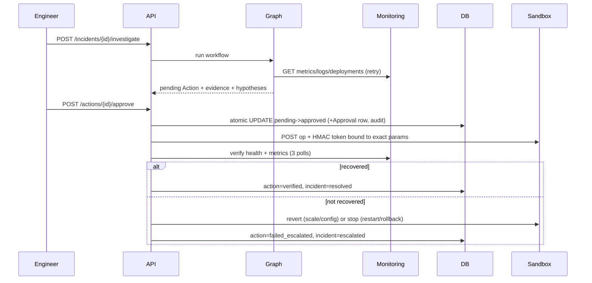

# Design, agent specifications and acceptance matrix

## Architecture

## Agent graph
`START -> triage -> investigate -> [retrieve -> plan -> verify -> (propose | escalate)] | escalate -> audit -> END`
Conditional edges: no evidence -> escalate; plan fails validation -> escalate. State is persisted to `workflow_runs.state` after every node.

## Agent specifications
| Agent | Responsibility | Inputs | Outputs | Approved tools | Errors | Hand-off |
|---|---|---|---|---|---|---|
| Triage | Classify urgency, confirm correlation | incident id, attached alerts | severity, category, status=investigating | DB read, deterministic rules | no alerts -> note | investigate |
| Log Investigation | Collect evidence, form cited hypotheses | incident, service | evidence rows (redacted), hypotheses with confidence/uncertainty | monitoring GET endpoints only (metrics, logs, health, deployments, traces, state), 3 bounded retries | API down -> degraded note; metrics+logs both missing -> escalate | retrieve or escalate |
| Runbook Retrieval | Find versioned instructions and prior incidents | category, hypotheses, log text, **user role** | top-3 passages with doc id/version/score | RAG index, role-based access filter, injection sanitiser | none found -> empty list | plan |
| Remediation Planner | Options, side effects, rollback, narrative | hypotheses, runbooks | ranked options, one recommended, narrative | LLM (optional, explain-only), allowlist validator | LLM timeout -> template fallback (degraded); invalid param -> escalate | verify -> propose/escalate |

## Incident assistant (chat)
- **Responsibility:** answer questions about incidents using stored data only. **Input:** message (max 500 chars, redacted before storage), optional incident id. **Output:** markdown answer, citations, suggested follow-ups, source (`rules` or `llm:<provider>`).
- **Approved tools (all read-only):** incident summary, hypotheses, evidence, runbooks, actions/options, timeline, incident list, dashboard stats. No tool can call the remediation or approval code.
- **Routing:** deterministic regex intent classifier; imperative verbs (approve, restart, rollback, scale, resolve and similar) are refused. **Failure behaviour:** unknown incident, no investigation yet, or insufficient evidence are stated plainly; LLM failure falls back to the rules answer.
- **Hand-offs:** actions go to the human Approval queue; investigations are started from the AI investigation page.

## Deterministic code vs ML vs LLM
| Step | Technique |
|---|---|
| Alert validation, thresholds, severity, correlation key/window, duplicate flagging | Deterministic (`backend/rules.py`, `backend/core.py`) |
| Infrastructure log signal extraction, hypothesis confidence | Deterministic regex heuristics (`agents/signals.py`) |
| SOC alert true-positive estimate | **Traditional ML**: logistic regression trained offline on labelled synthetic alerts, exported as coefficients and scored in pure Python (`agents/soc.py`, `scripts/train_soc_model.py`). Held-out metrics in `docs/soc_eval.md` |
| Runbook and resolved-incident retrieval | TF-IDF cosine (classic IR, not an LLM), role-filtered, injection-sanitised |
| Choice of remediation operation and parameters | Deterministic mapping from validated signals |
| Chat intent routing, tool selection, refusal of action requests, answer text | Deterministic (`agents/chat.py`); optional LLM rephrase, rejected if it adds numbers or drops citations |
| Narrative/explanations | LLM if configured, else template; numbers must exist in evidence or the text is rejected |
| Authorization, approval gate, allowlist, execution, verification, recovery | Deterministic backend code |

## ERD

## Workflow sequence (approve path)

## Security controls
RBAC on API (server-side) and UI; JWT with role read from DB per request; PBKDF2 passwords; allowlisted ops + parameter validation at plan time **and** again at execution time; atomic claim prevents double execution; approvals expire (default 30 min); optional separation of duties; sandbox requires an HMAC token bound to op + params (a leaked token cannot be reused for another action); secrets/emails/IPs redacted before storage; retrieved text sanitised for prompt injection and never influences the allowlist; retrieval filtered by role; full audit trail (actor, time, tool result).

## Acceptance matrix
| Requirement (assignment) | Where | Test |
|---|---|---|
| Related alerts clustered, source evidence kept | `core.ingest_alert` | `test_alert_storm_correlates_without_losing_alerts` |
| Root cause references real metrics/logs | `signals.detect`, `graph.verify` | `test_hypotheses_cite_real_evidence_and_secrets_are_redacted` |
| No mutating call without approval | `remediation`, sandbox token | `test_no_execution_without_approval`, `test_sandbox_rejects_calls_without_valid_token` |
| Failed remediation -> rollback/escalation | `remediation.execute_action` | `test_failed_remediation_escalates_and_stops`, `test_failed_scale_is_reverted` |
| Invalid input / API outage / LLM timeout | validators, retries, fallback | `test_invalid_alerts_rejected`, `test_transient_outage_*`, `test_hard_outage_*` |
| 10 reproducible scenarios, 5 categories | `data/scenarios.py` | `test_all_ten_scenarios_meet_expectations` |
| p50/p95, error rate, tokens, cost | `scripts/run_eval.py`, `/dashboard` | `docs/evaluation_report.md` |
| RBAC on UI and API | `ui.guard`, `security.require_role` | `test_unauthenticated_and_role_enforcement`, `scripts/ui_smoke.py` |
| Optional file import with row-level validation, RBAC | `backend/importer.py` | `test_validation_reports_bad_rows_and_rbac`, `test_soc_sample_covers_all_playbooks_and_is_idempotent` |
| Security alerts: insufficient evidence stated, never auto-actioned | `agents/soc.py`, `graph.py` | `test_real_alerts_without_signals_say_insufficient_evidence_and_cite_playbook` |
| Untrusted alert text and PII | `rag.sanitize`, `redaction.py` | `test_prompt_injection_in_description_is_neutralised`, `test_pii_redacted_in_evidence` |
| Long-running agent task off the request path | `/incidents/{id}/investigate/async` | `test_async_investigation_worker_persists_result` |
| Structured logs with correlation ids | `structured_access_log`, `graph.wrap` | `test_request_id_header_and_structured_log`, `test_agent_steps_are_logged_with_incident_id` |
| Chat is read-only and refuses state-changing requests | `agents/chat.py` | `test_action_requests_are_refused_and_audited`, `test_prompt_injection_cannot_trigger_actions` |
| Chat answers cite real evidence and state uncertainty | `agents/chat.py` | `test_root_cause_cites_real_evidence_and_states_uncertainty`, `test_insufficient_evidence_for_security_alert_is_stated` |
| Chat privacy, redaction, rate limit, LLM guard | `backend/main.py`, `agents/chat.py` | `test_history_is_private_per_user_and_clearable`, `test_user_message_is_redacted_before_storage`, `test_rate_limit`, `test_llm_rewrite_is_guarded` |
